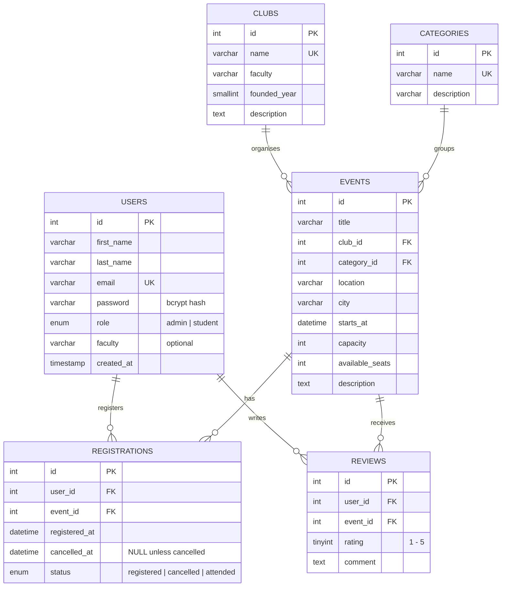

# CampusEvents – Entity Relationship Diagram

CampusEvents is a single-page application for student events. Students discover events
(concerts, hackathons, sports, workshops, trips), register and review them; administrators
manage events, clubs, categories, registrations and users.

## Relationships

| Relationship            | Type | Rule                                                                  |
|-------------------------|------|-----------------------------------------------------------------------|
| Club → Events           | 1:N  | A club organises many events; an event has exactly one organiser.     |
| Category → Events       | 1:N  | A category groups many events; an event belongs to one category.      |
| User → Registrations    | 1:N  | A student can register for many events (max. 3 upcoming at a time).   |
| Event → Registrations   | 1:N  | An event has many registrations (limited by `available_seats`).       |
| User → Reviews          | 1:N  | A student writes many reviews, but only **one review per event**.     |
| Event → Reviews         | 1:N  | An event can have many reviews.                                       |

`USERS` + `EVENTS` + `REGISTRATIONS` / `REVIEWS` form two many-to-many relationships
(students ↔ events) resolved through the `registrations` and `reviews` tables.
